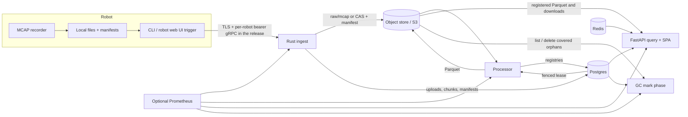

# Robot Vault architecture

Use this reference to understand Robot Vault's current components, trust
boundaries, and data flow. It is for developers and operators investigating how
the services interact. Operator commands live in [`../README.md`](../README.md)
and [`OPERATIONS.md`](OPERATIONS.md); the documentation map is
[`README.md`](README.md).

## Purpose and scope

Robot Vault is a single-node, on-prem robotics data and training-refinery
platform. Robots retain recordings while offline. An operator uses the robot CLI
or web UI to upload stable MCAP files when connectivity exists. The server
verifies and registers source bytes, streams them through a bounded processing
pipeline, exposes registered Parquet through an authenticated query/UI front
door, and in Pro creates signed dataset cuts and LeRobot v3 bundles.

Two release editions share the same security posture. The core release runs
the core images; Pro images are delivered separately:

| Edition | Data path |
|---|---|
| `core` | upload → integrity → registered Parquet → query/UI |
| `pro` | core + episodes → AV1 media → DEFECT/RISK QA → signed cuts → export |

The supported release workflow drives the query router set, processor stage
flags and the Compose files (core, or core plus the Pro release overlay with
the exporter) from one `EDITION=core|pro` choice. `EDITION=core` is the
default.

Current scope is one Docker Compose host. Postgres is the metadata/control-plane
system of record; the object store (RustFS, S3 API) holds source and derived objects. Scale-out primitives
are bounded claims, renewable leases, idempotent reservations and explicit
registries—not a message broker. Multi-region replication, tenant provisioning,
background robot scheduling and a control plane are not implemented.

## System overview



There is no Grafana proxy, Kafka/Redpanda/NATS path, OpenTelemetry collector,
Foxglove bridge, Envoy gateway or standalone Parquet converter in the current
system.

## Robot-side storage and upload

Phase 01 manages files and sidecar manifests below a confined robot root. It
uses descriptor-rooted operations, atomic manifest writes, locking, identity
revalidation and a five-second stability gate so a recording cannot be hashed
or deleted while it is changing. Retention protects pending, failed and
in-flight data by default and requires explicit authority plus verified server
completion evidence before deleting uploaded files.

Phase 02 is operator-triggered. There is no SSID scheduler. The agent:

- takes its identity only from the required `robot_id` in its config;
- computes and persists whole-file SHA-256 automatically;
- sends small files through `UploadSmall` and larger files as fixed 5 MiB
  streaming chunks by default (validated range 5–8 MiB; `UploadSmall` retains
  its separate 48 MiB file threshold);
- uploads several whole files concurrently, bounded by client strategy and the
  server-advertised per-robot limit;
- paces unary and streaming payload bytes through one thread-safe allowance
  per upload queue, including retries and resumed parts, and retries transient
  gRPC failures with bounded full-jitter backoff and a cumulative byte budget; and
- never applies upload-time compression; recorders should use native MCAP chunk
  compression.

Expected manifest or file-preparation failures are reported for that file while
other selected files continue. An unexpected programming error or cancellation
still propagates. The CLI exits nonzero if selected work fails; an intentional
skip or empty selection is successful. The bandwidth value is binary Mibit/s;
each queue/process has its own allowance, with an initial one-second allowance
and transport-sized bursts.

`ResumeUpload` negotiates durable multipart resume version 1. Postgres retains
the storage upload ID, fixed part boundaries, session token, and each accepted
part's ETag and digest. Progress becomes resumable only after storage confirms
the part and its receipt commits. The robot sends the missing part set, including
gaps between saved parts, with the original numbers and offsets. Both agent and
ingest restarts preserve that progress. The agent always requests resume version 1; the ingest server must support it.

The upload lock serializes attempts. A stale session token requires another
probe, and conflicting file identities are rejected. The assembled object is
stream-read to verify its whole-file SHA-256 before the completion row makes it
eligible for processing. Unfinished sessions expire after seven idle days;
ingest cleans them under the same lock, while general GC protects registered
sessions from its orphan-part sweep.

## Ingest and source integrity

Phase 03 is a Rust/Tonic service with `Upload`, `UploadSmall`, status/list and
health RPCs plus an internal HTTP admin/metrics listener. Before object I/O it
transactionally reserves the immutable tuple:

`(upload_id, robot_id, filename, size, expected_sha256)`.

Cross-process advisory locking serializes the same upload id. Conflicting reuse
fails; an exact completed streaming replay returns the recorded result without
object I/O, while a CAS-enabled `UploadSmall` replay re-PUTs its already-verified
unary bytes and ensures the per-upload CAS manifest artifacts exist. A
failed/crashed retry reuses its session's key. Replacing an expired or lost
multipart session assigns a new raw key, isolating it from delayed operations
on the old session. The completed recording's key remains fixed.
Streaming uploads require a
64-hex expected SHA, strict ordered chunks, byte-count/final-chunk gates and a
matching computed digest. Release unary uploads require the same client digest;
development-only legacy unary completions remain unverified, and the processor
does not claim them. Optional per-chunk hashes add an earlier corruption check.

Large/streaming files always use `raw/mcap/...`. With `ENABLE_FILE_CAS=true`,
`UploadSmall` can write `cas/files/<sha256>` plus
`manifests/<robot_id>/<upload_id>.json`; streaming uploads do not use CAS.
Completion is acknowledged only after the authoritative Postgres row commits.

Release ingress is TLS with a per-robot bearer credential. The release has two
security profiles, set by `INGEST_SECURITY_PROFILE`:

- `token` (default): the robot verifies the server certificate against the
  pinned ingest CA and sends its own `ignr1.` credential. The server reads the
  robot id from the credential row, never from request metadata. The shared
  fleet token is refused on the data plane.
- `mtls`: the same, plus a client certificate under the ingest CA with exactly
  one URI SAN `spiffe://robot-vault/robots/<percent-encoded-robot-id>` matching
  the credential's robot.

Every data-bearing RPC is scoped to the authenticated robot in release. Listing
is forced to that robot; status/resume verify row ownership. Development can run
plaintext/local-token mode explicitly.

### Robot onboarding and the trust chain

The query service is the only public HTTPS socket, so it also serves the robot
installer. No outside host, signing key or channel is involved, and the flow
works in an air-gapped deployment.

```text
 admin browser (OIDC, admin role)                  robot (Linux amd64, root)
   | POST /api/admin/robots/{id}/enrollment-code     |
   v                                                 |
 query :443 --proxy--> ingest :8080 mints  ign1.<pin>.<secret>   (pin = SPKI of the ingest CA)
   | 201 {code, install_command, robot_bootstrap_sha256, vault_ingest_endpoint}
   |                                                 |
   |  admin copies install_command ----------------> 1 curl -k https://<vault>/robot -o $f
   |                                                 2 sha256sum -c   (digest from the command)
   |                                                 3 sudo sh $f --vault .. --ingest .. --code ..
   |  GET /ca.crt (query, no auth) <-----------------4 fetch the CA, check the pin from the code
   |  GET /robot/agent-linux-amd64.tar.gz <----------5 fetch the agent, check SHA-256 and size baked into robot.sh
   |                                                 6 Enroll over TLS pinned to that CA --> ingest :50051
   |                                                   (the code leaves the robot only after the verified handshake)
   |                                                 7 uploads: TLS + per-robot ignr1. bearer --> ingest
```

The chain of trust: the admin's authenticated HTTPS session gives the `robot.sh`
digest; `robot.sh` carries the agent digest; the code carries the CA pin; the
pinned CA protects the code and every upload. Nothing that `robot.sh` downloads
is trusted before its check, and no credential travels on those requests. The
`mtls` profile does not support this flow (the robot has no client certificate
when it enrolls); robots under `mtls` are set up by hand. Operator steps are in
[`OPERATIONS.md`](OPERATIONS.md#add-a-robot).

`/readyz` performs a unique `_health/ingest/<uuid>` object put/delete and
Postgres `SELECT 1`. Bucket/policy administration belongs to a one-shot; the
long-running ingest identity cannot create or list buckets.

## Processing and quality refinery

The processor polls completed uploads and atomically claims one through
`processing_status`. Each claim receives an attempt UUID, owner and finite
renewable lease. Heartbeats and terminal registry writes match the live token;
an expired/stale worker cannot acknowledge or erase a newer attempt's database
state. Parquet, media and QA object keys and registry rows are attempt-scoped.
Claim replacement locks the authoritative status row and then prunes the
superseded generation's registries in the same transaction using fresh
`READ COMMITTED` snapshots. Production readers expose only the published or
currently authoritative generation, while bounded GC can reclaim abandoned
attempt objects. Attempts increment at claim time and dead-letter after the
configured bound.

One streaming MCAP pass writes v1 chart rows plus v2 typed families to
registered Parquet. Pro adds episode segmentation, media encoding, PII
processing and QA scoring to the same pass.

## Query service and user interface

Phase 05 is the only public browser/API front door. Postgres supplies fleet,
upload, episode, cut, export and file-registry metadata. Query planning resolves
`parquet_files` for exact robot/topic/time/schema pruning. The registry is the
only source of files; the service never lists the lake. DuckDB reads payloads
directly from S3 and pins UTC plus nanosecond-safe timestamp comparisons.

Every DuckDB connection shares a process-wide capacity pool, a per-connection
memory ceiling, and a wall-clock execution deadline that interrupts the engine
before returning a stable 504. Registry plans are rejected before object reads
when their recorded file, row or byte counts exceed configured admission
limits, and explicit time windows have a maximum width. An authenticated limits endpoint lets Orbit use the active range without
copying a constant. Admission, saturation, active work, and deadline outcomes
are exported as bounded-label metrics. Normal close, error, and timeout paths
return the same capacity lease exactly once.

The React SPA provides Postgres-backed Overview KPIs, fleet/upload browsing,
separate stream/SQL exploration modes, Pro episode/QA and dataset/cut views,
offline provenance downloads, and a PromQL/ECharts observability page. Charts
carry a text summary and native table alternative. Local help plus a wildcard recovery page keep stale routes from becoming empty shells.
Browser downloads default to a same-origin query proxy, so the object store need not be
published.

Intake's automatic S3 discovery has a bounded scan; failure does not masquerade
as an empty result. Intake, Review, and Verification apply related URL filters
as one update, preserving unrelated search parameters and resetting pagination
with the filter change.

Release authentication is real OIDC Authorization Code + S256 PKCE. The backend
verifies RS256 issuer/audience/JWKS claims; the SPA keeps access/refresh tokens
in `sessionStorage`, uses single-use state, single-flighted refresh and strict
same-origin API calls. Data routers require at least viewer; operator/admin
dependencies are additive. Development token issuance exists only when the
backend explicitly reports dev mode. Query readiness warms OIDC verification
and checks Postgres.
`/metrics` has a separate release bearer token.

## Dataset cuts and exports (Pro)

Pro adds signed dataset cuts and exports (LeRobot v3 and eligible MCAP). Core
bootstraps the exporter's database role and object-store user as reserved
identities, so a later move to Pro finds them.
`tools/dataset_verify.py` is a project-independent Python + `cryptography`
verifier for a cut's canonical id, optional signature, and the hashes of the
listed source inputs on an offline machine.

## Storage and registry contract

Representative object prefixes:

```text
raw/mcap/<robot>/<yyyy>/<mm>/<dd>/<upload-id>.<ext>
cas/files/<sha256>
manifests/<robot>/<upload-id>.json
processed/parquet/<robot>/_attempts/<attempt-id>/<topic>/<yyyy>/<mm>/<dd>/rows-<upload-id>.parquet
processed/parquet/v2/<family>/<robot>/_attempts/<attempt-id>/<topic>/rows-<upload-id>.parquet
processed/media/<robot>/_attempts/<attempt-id>/<episode>/<topic>/chunk-<n>.mp4
qa/reports/<robot>/_attempts/<attempt-id>/<scope>/<id>.json
exports/<dataset>/<format>/attempts/<attempt-id>/...
```

The exact schema is the ordered migration set in `db/migrations/`; table
semantics are summarized in `docs/DB_SCHEMA.md`. `db/migrate.py` holds an
advisory lock, records exact migration filenames and SHA-256 checksums, rejects
gaps/renames/edits and applies each migration transactionally.

The GC service is the only S3 deleter. Its mark phase queries the registries for
raw, manifests, Parquet, media, QA and exports. A successfully queried empty
registry is authoritative; missing/failed/unmodelled coverage skips before
listing. CAS object reachability is intentionally unmodelled, so CAS objects are
never swept (only stale CAS multipart uploads may be aborted). Global age and
delete limits plus dry-run-by-default constrain every sweep.

## Deployment and trust boundaries

### Development

`docker-compose.yml` builds/mounts the working tree and uses documented local
credentials. `make stack-up` starts Postgres, the object store, Redis, ingest, processor,
query/UI, robot UI and GC; a Pro development stack also starts the exporter
(Pro). Operator UI ports and GC metrics bind to
loopback by default; ingest/Postgres/the object store remain internal unless a loopback
debug overlay is explicitly selected. Widening the development query/UI bind
while its token issuer can mint an administrator credential requires a separate
explicit acknowledgement and emits a warning. Dev is not a production security
boundary.

### Standalone source release profile

`deploy/docker-compose.release.yml` is standalone: no builds, no source-tree
binds, no `:latest`, no container names, digest-pinned upstream images and
locally verified first-party version tags with `pull_policy: never`. The
object store is the first-party `robot-vault-objectstore` image (pinned
upstream RustFS plus patched OpenSSL; contract in
[`development/objectstore/CONTRACT.md`](../development/objectstore/CONTRACT.md)).
The profile publishes only query HTTPS and ingest TLS gRPC. First-party processes run UID/GID 10001,
read-only root filesystems, no Linux capabilities, no-new-privileges, bounded
noexec tmpfs, and explicit writable volumes.

The release credential flow is deliberately split:

- `db-migrate` alone receives the Postgres owner for schema changes;
- `postgres-roles-ready` creates/rotates five fixed unprivileged roles and
  verifies table/column ACLs;
- `objectstore-access-ready` runs the versioned toolkit image with one reviewed
  script and five policy JSON Compose configs. It creates the bucket and five
  fixed prefix-policy identities on the object store; and
- ingest, processor, query, GC and (Pro) the exporter receive only their
  matching database URI and S3 secret. Core still bootstraps the exporter's
  role and object-store user as reserved identities, so a later move to Pro finds
  them.

The three one-shots gate all runtimes. `release-up` registers an EXIT cleanup
before startup and removes them on success, readiness/edition failure, and
HUP/INT/TERM, so owner/root/runtime bootstrap secrets do not remain in stopped
container metadata. Runtime secrets are still environment variables visible to
Docker administrators; the host and Docker daemon remain trusted.

Host preflight validates authoritative env-file permissions, fixed identities,
credential separation, database URL encoding/target, TLS PEM/key/SAN/EKU/chain
and expiry, edition/profile
agreement, image provenance, healthchecks and policy mounts. Release state is
in named volumes. Before `up`, `release-up` refuses when Compose would recreate
an existing data volume, and `up` itself runs with no input so Compose can
never wait at a prompt. After readiness it checks that the query API, the
processor, the served UI and (Pro) the exporter report one edition and one set
of versions. See [`OPERATIONS.md`](OPERATIONS.md#what-release-up-checks).

## Observability and performance evidence

Prometheus is an optional release profile. Services expose bounded metrics;
Overview product KPIs come directly from Postgres and remain available without
Prometheus. The release profile also has an internal, non-root operational
collector for volume capacity, queue age, backup freshness, and public-chain
certificate expiry. It reads four database tables through a dedicated
read-only role and cannot access private keys, S3 credentials, or the Docker
socket. Alerts reach an external Alertmanager only when its validated endpoint
is configured; an operator-owned receiver remains an external prerequisite.
There is no shipped Grafana service or proxy.

Measured on a single host with no TLS and a warm page cache:

- one 500.99 MiB MCAP, one stream: 193.6 MiB/s median;
- eight-file backlog, two streams: 193.4 MiB/s aggregate; and
- upload-time compression was slower or ineffective for normal compressed
  MCAP, so upload does not compress.

These are not WAN/robot-link claims. The shaped-network harness verifies
ingest reachability, the advertised stream cap, and measured link shaping, but
the matrix itself remains unrun. Query-cache measurements and their caveats
live in the phase-05 technical docs.

## Deliberately not implemented

- background SSID/scheduling-window uploads and robot heartbeat/control plane;
- Kafka/Redpanda/NATS event spine or OpenTelemetry collector;
- standalone Parquet converter, Envoy, Foxglove bridge or Grafana;
- multi-region replication, automatic tiering and multi-tenant provisioning;
- verified real-WAN performance or a formal multi-node deployment;
- a second unified configuration framework—the existing JSON, service env,
  and release inputs retain distinct ownership; and
- a wholesale query-engine rewrite. The current DuckDB planner prunes
  registered keys; broader pushdown work requires a measured need.

## References

- quick start and current status: `../README.md`
- documentation ownership: `README.md`
- release/backup/upgrade operations: `OPERATIONS.md`
- testing and evidence: `TESTING.md`
- configuration: `CONFIG_REFERENCE.md`
- database tables/migrations: `DB_SCHEMA.md`, `../db/migrations/`
- protocol: `../proto/upload.proto`
- phase internals: `../phases/*/docs/technical.md`
