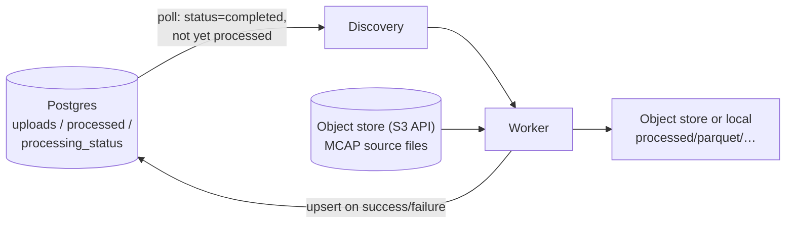

# Phase 04 — Processing pipeline technical guide

## Scope

This guide is for developers and operators working on the processor. It covers
how completed MCAP uploads become registered Parquet. Pro adds episode, media,
and quality-assurance (QA) outputs (see "Pro stages").

- Standalone processor service (Python, `phases/04-processing-pipeline/src/processor/`) that discovers completed uploads and writes partitioned Parquet
- Discovery is **poll-based**, not event-driven: `list_unprocessed_uploads()` (`processor/core.py`) queries Postgres for uploads where `status = 'completed'` and `integrity_verified = true`, not yet present in `processed`, and not `dead_letter` in `processing_status`. In `--watch` mode (used by the Docker image's default `CMD`) this query re-runs every `--interval` seconds — the CLI flag itself defaults to 10s, but `docker-compose.yml` passes `--interval 5`. There is no message broker involved in triggering processing.
- Uses `mcap` to iterate messages and `pyarrow` to write Parquet with Snappy compression
- Base image: pinned Ubuntu 24.04 with distro Python 3.12 and a copied runtime
  venv. `mcap-ros2-support` dynamically decodes the complete `ros2msg` schema
  embedded in each MCAP, so no ROS apt packages, generated ROS classes, kernel
  headers, or compiler toolchain ship. Third-party Python dependencies come
  from the hash-pinned `requirements.lock.txt`; the Dockerfile then installs
  the local shared-config and processor packages with `--no-deps`.
- Reads MCAP source files from either the object store (`s3://bucket/key`, when `S3_BUCKET`/`S3_ENDPOINT`/AWS creds env vars are set) or a local path — see `_extract_minimal_topics_to_parquet()` in `core.py`.
- **Both source paths stream.** The object is never held whole. The S3
  branch reads through a `MCAP_READ_BUFFER_BYTES` (4 MiB) read-ahead window over
  PyArrow's `open_input_file` handle, kept open for the reader's whole life;
  peak memory *of the read* is that window plus one decompressed MCAP chunk,
  whatever the object size (measured growth rate against object size: 0.0024,
  versus 1.0018 when the whole object is read).
  - **Decoded-row memory is bounded.** `_IncrementalParquetSink` maintains one
    buffered writer per topic, all against a
    fixed `arrow_schema(SCHEMA_VERSION)`, and flushes/clears each buffer every
    `PARQUET_FLUSH_ROWS` (50,000) rows. An early all-null group therefore cannot
    drift the schema, and message count does not cause unbounded list growth.
  - **Measured memory behaviour:** a
    207.1 MB / 12,800-message
    bag cost 8.0 MiB over baseline (657 B/msg) while a 17.5 MB /
    200,000-message bag cost 81.2 MiB (425 B/msg) — an object 12x smaller for
    10x the memory. After incremental sinks, real CDR decode measured peak RSS
    delta **62.96 MiB at 100k messages vs. 55.37 MiB at 300k** —
    flat, where a whole-bag buffer at ~425-660 B/msg would have predicted 122-189 MiB
    at 300k. Row groups verified on the stored objects: 6 x 50k row groups
    for the 300k-message run; row counts exact. Streaming instead of a
    `data = f.read()`/`BytesIO` read also reduces peak RSS on a 515 MiB MCAP
    from **614 to 113 MiB (5.4x)** for identical output.
  - The window size is measured, not guessed: PyArrow issues one HTTP range
    request per `read()` and mcap reads record headers a few bytes at a time,
    so an unbuffered handle took **13.5 s and 11,336 range requests** for that
    object versus **1.8 s and 132** at 4 MiB. See the table in `core.py`.
  - **MCAP reads have hard memory limits** (`processor/mcap_bounds.py`). The
    mcap library trusts sizes in the file: zstd output is sized from the frame
    header, lz4 has no output limit, and a file without a summary is sorted
    in memory. A 98 KB file can therefore expand to gigabytes. The processor
    uses its own bounded reader. It checks each limit before it allocates
    memory, and it checks the real Chunk record, not only the summary index:
    - `PROCESSOR_MCAP_MAX_CHUNK_BYTES` (default 512 MiB): one Chunk record,
      stored size and declared size. Decompression stops one byte after the
      declared size, so a frame that expands further is rejected.
    - `PROCESSOR_MCAP_MAX_MESSAGE_BYTES` (default 256 MiB): one message. It
      must not exceed the chunk limit.
    - `PROCESSOR_MCAP_MAX_CHANNELS` and `PROCESSOR_MCAP_MAX_SCHEMAS` (default
      4096 each). Schema and channel records together are limited to 64 MiB.
    - `PROCESSOR_MCAP_MAX_BUFFERED_BYTES` (default 1 GiB): messages held while
      chunks are merged in log-time order (data plus 320 bytes per message).
      Chunk indexes with false start times hit this limit.
    - A file with chunk indexes is read in log-time order, like the mcap
      library. A file without chunk indexes is read once, in file order.
      Attachments and metadata are skipped without being read.
    - A violation raises `McapLimitError`. The upload becomes `dead_letter`
      on the first attempt (see "Idempotency and recovery"). Other uploads
      continue. Invalid limit values stop `run_once` before any claim.
    - Measured on 2026-10-08 in the processor image with a 1 GiB memory
      limit: a 98,706-byte MCAP whose Chunk declares 4 KiB but expands to
      3 GiB OOM-killed the mcap library reader (exit 137). The processor
      rejected it in under 0.01 s with a 76 MiB peak RSS.
  - Trap for future edits: do **not** hand mcap an `io.RawIOBase`.
    `mcap.stream_reader.StreamReader.__init__` special-cases that type by
    wrapping it in a `BufferedReader` it owns, whose destructor closes the
    underlying stream — surfacing mid-iteration as "I/O operation on closed
    file". A PyArrow `NativeFile` and an `io.BufferedReader` both avoid that
    branch.
- Partition layout (every path belongs to the processing attempt):
  - Per-topic: `processed/parquet/{robot_id}/_attempts/{attempt_id}/{topic}/{YYYY}/{MM}/{DD}/rows-{upload_id}.parquet`
  - Typed (v2 schema families): `processed/parquet/v2/{family}/{robot_id}/_attempts/{attempt_id}/{topic}/rows-{upload_id}.parquet` — see "v2 typed schema families" below
  - There is no combined `_all` copy. Every row is in exactly one per-topic
    file. Files use `rows-*` below the reserved `_attempts` segment, so a
    blind `part-*`/direct-topic glob misses stale attempt objects; files are
    discoverable only through their registry.
  - Written to the object store when S3 env vars are configured, otherwise to the local `--parquet-root` path (dev fallback).
- Registry: Postgres tables `processed`, `processed_topics`, and `processing_status` are used for idempotency and attempt/failure bookkeeping (see "Idempotency and recovery" below). There is no local SQLite index and no index-database flag.
- Message decoding: CDR-encoded messages are decoded by the official pure-Python `mcap_ros2.decoder.DecoderFactory` (`processor/cdr_decode.py`) against the exact MCAP `Schema` record. A decoder is scoped to one MCAP because schema IDs are file-local. Missing schemas, `ros2idl`/other unsupported schema encodings, malformed `ros2msg` definitions, and corrupt CDR bytes all increment the labeled decode-failure metric and feed the per-upload all-failed ratio gate; none is accepted through a guessed generated class or JSON fallback. JSON payloads are supported only when the MCAP channel explicitly declares `message_encoding == "json"`, primarily for development fixtures.
- Topic detection and normalization (`processor/supported_types.py`, `_normalize_topic()` in `core.py`):
  - By default, only processes messages whose `schema.name` matches the
    generated catalog of reviewed ROS 2 message types, mapped to normalized
    topic buckets (see [supported_ros2_topics.yaml](supported_ros2_topics.yaml),
    which mirrors `ROS2_TYPE_NORMALIZATION` in code). CLI flag `--topics` can
    override with an explicit allowlist of normalized-topic prefixes.
  - `sensor_msgs/msg/Imu` is further split into `imu/linear_accel` or `imu/angular_vel` based on hints in the raw topic name (falls back to `imu` if no hint matches).
  - Other types map 1:1 to a normalized bucket name (e.g. `sensor_msgs/msg/Image` → `image`, `sensor_msgs/msg/PointCloud2` → `pointcloud2`).
  - Per message, three numeric fields (`x`, `y`, `z`) are extracted for charting via `extractors.extract_xyz()` — field mapping is type-specific (e.g. IMU linear/angular, Twist linear, Odometry twist/pose, NavSatFix lon/lat/alt, Image/PointCloud2 → width/height/null). Unsupported/non-numeric shapes yield null x/y/z but the row (with topic + timestamp) is still written.
  - Six of those types (JointState, Odometry, Twist, TFMessage, CameraInfo, PointCloud2) additionally get full typed extraction into the v2 schema families — see "v2 typed schema families" below. Every one of them is also in the catalog; the typed families add no catalog entries.
- Integrity gates:
  - Only processes uploads with `status = 'completed'` and
    `integrity_verified = true` in Postgres
  - A missing source file raises `FileNotFoundError` rather than being silently marked processed
- Config: `--topics` allowlist (optional, comma-separated, default = full
  supported catalog), `--parquet-root`, `--interval` (watch mode),
  `ROBOT_VAULT_EDITION` (default `core`), and the Pro stage switches (see
  "Pro stages"). Postgres connects through `DATABASE_URL`; the object store uses
  `S3_BUCKET`/`S3_ENDPOINT`/`S3_REGION`/`AWS_ACCESS_KEY_ID`/
  `AWS_SECRET_ACCESS_KEY`/`S3_SECURE`.
- Observability: Prometheus metrics on `:8000` — `processor_duration_seconds`, `processor_processed_uploads_total`, `processor_processed_empty_uploads_total`, `processor_processed_rows_total`, `processor_failures_total{reason}`, `processor_messages_read_total`, `processor_messages_skipped_by_schema_total{schema}`, `processor_cdr_decode_failures_total{schema}`, `processor_typed_rows_total{family}` (v2 rows, additional to `processor_processed_rows_total`, which stays the v1 message count). Pro adds episode, media, QA and PII metrics.

## Architecture
- Discovery: `run_once()` atomically claims verified completed/unprocessed uploads through the unique `processing_status.upload_id` conflict path, up to 50 distinct uploads per pass. Its conditional upsert admits only pending, failed, or expired leases, without requiring UPDATE privilege on immutable `uploads` rows. It assigns a fresh `attempt_id`, keeps the claim row locked, then removes older-generation registry rows with fresh `READ COMMITTED` snapshots before the same transaction commits. The later snapshots are required: they see a predecessor registry transaction that committed while the replacement waited for the claim lock. A crashed owner is recoverable; a stale replica cannot acknowledge, register, overwrite, or delete its replacement's output.
- Worker: for each candidate upload, stream its MCAP from S3 or local disk,
  filter supported schemas, extract v1/v2 rows into bounded Parquet sinks, and
  feed bounded segment/media/QA collectors without accumulating the upload in
  memory
- Writer: write one per-topic partitioned Parquet file per upload, plus one v2 typed file per (family, topic) for the six message types that have a typed extractor
- Bookkeeping: attempts increment at claim time. Every `processed_topics`,
  `parquet_files`, `episodes`, `media_files`, and `qa_reports` write locks and
  validates the live unexpired token in its own transaction. Success writes
  `processed.attempt_id` (the authoritative generation) and
  `processing_status` (`completed`/`completed_empty`) in one token-conditional
  transaction. Failure is token-conditional and deletes only its own partial
  registry before becoming `failed` or `dead_letter`. Object bytes are never
  deleted inline; unreachable attempt paths remain under GC-covered prefixes.

Mermaid (high level):

## Data model (initial)
- Parquet schema per output file: `ts` (timestamp, ns, UTC, no tz), `topic` (string), `x`, `y`, `z` (float64, nullable)
- `robot_id`, `attempt_id`, and `upload_id` are encoded in new output paths;
  they are not embedded row columns.

## v2 typed schema families

The v1 schema above is three numeric slots that mean something different per message type — it cannot express a message with more than three numbers in it, which most robot messages need. Version 2 is therefore not one schema but a **family of named, fixed schemas** (`processor/parquet_schema.py`), written **in addition to** the v1 files, never instead of them.

- **Additive by construction.** Every message still produces exactly the v1 rows it did before. `rows_written` (the return value, `processed.rows_written`, and the `completed` / `completed_empty` decision) still counts v1 rows only — a JointState message is one v1 row whether it carries 6 joints or 12. `processed_topics` remains v1 bookkeeping. `SCHEMA_VERSION` stays **1**; the families live at a separate `TYPED_SCHEMA_VERSION = 2` constant, so output fencing changes ownership paths, not either file schema.
- **Layout:** `processed/parquet/v2/{family}/{robot_id}/_attempts/{attempt_id}/{topic}/rows-{upload_id}.parquet`, i.e. `parquet_prefix(root, 2, family=...)` + robot + generation + topic. Family sits directly under the version segment because it identifies the payload schema. New files may add nullable columns; the per-file registry column list and schema hash describe the actual shape. The topic is flattened to a single segment (`imu/linear_accel` → `imu__linear_accel`). No date partitioning — one upload attempt writes one file per (family, topic) and the registry carries its `[start, end]` range, so the YYYY/MM/DD depth v1 uses to make a blind glob prunable buys nothing here.
- **Source identity:** every v2 family ends with the nullable `raw_topic` column, which preserves the exact MCAP channel name. `topic` remains the normalized bucket used by existing queries and registry discovery. Sources such as `/left/joint_states` and `/right/joint_states` can share a file; readers needing individual sources should filter or group by `raw_topic` as well as joint name. The registry hash covers the full column list, including `raw_topic`.

- **Families and columns** (all schemas lead with `ts`, `topic` and append `raw_topic`; all payload columns nullable):

  | family | source type | payload columns | rows |
  |---|---|---|---|
  | `joint_state` | `sensor_msgs/msg/JointState` | `joint_name`, `position`, `velocity`, `effort` | one per joint per message |
  | `odometry` | `nav_msgs/msg/Odometry` | `px,py,pz`, `qx,qy,qz,qw`, `vx,vy,vz`, `wx,wy,wz` | one per message |
  | `twist` | `geometry_msgs/msg/Twist` | `linear_x,linear_y,linear_z`, `angular_x,angular_y,angular_z` | one per message |
  | `tf` | `tf2_msgs/msg/TFMessage` | `parent_frame`, `child_frame`, `tx,ty,tz`, `qx,qy,qz,qw`, `is_static` | one per transform |
  | `camera_info` | `sensor_msgs/msg/CameraInfo` | `width`, `height`, `fx`, `fy`, `cx`, `cy`, `distortion_model` | one per message |
  | `pointcloud_stats` | `sensor_msgs/msg/PointCloud2` | `n_points`, `sample_n`, `x_min/x_max`, `y_min/y_max`, `z_min/z_max` | one per message |

- **Long/tidy, not wide.** A column per joint makes the column set a function of the robot in the bag: a 6-joint arm and a 7-joint one could not share a file, let alone a family, and every new joint set would need a schema version. That is precisely the inferred-schema failure mode the fixed-schema discipline exists to prevent (a `ParquetWriter` fixes its schema on open — see `_IncrementalParquetSink`'s docstring). Long files answer "position of joint X over time" with a filter, and the wide view is a pivot the reader chooses. `tf` is long for the same reason (a column pair per frame relation is unbounded).
- **`is_static` comes from the raw topic** (`/tf_static` vs `/tf`), because both normalize to the same `tf` bucket and share one file — static TF is the robot's calibration, which downstream QA can check.
- **`twist` keeps all six components.** v1 has three numeric slots and spends them on `linear.{x,y,z}`, so without this family no file in the lake would carry the *commanded* yaw rate. Column names mirror the message (`linear_*`/`angular_*`) rather than reusing `odometry`'s `vx..wz`: this whole row is a twist, so there is no pose half to disambiguate from, and they are the names a velocity-command consumer expects. Keeping the four "usually zero" components is deliberate — dropping them would lose data, and a holonomic base commands `linear.y`.
- **Adding a family is additive, and is not a version bump.** Every existing family's column set — and therefore the `schema_hash` its already-written files carry in `parquet_files` — is untouched; the new family gets its own directory and its own registry rows; no historical file is moved or rewritten. The contract that follows for readers: a family's **absence** for a given upload is normal and permanent unless that upload is reprocessed. A consumer must treat a missing family as normal.
- **PointCloud2 is stats-only** (no raw point-cloud media in v1). Bounds are computed from an **evenly distributed sample of at most `MAX_POINTCLOUD_SAMPLE` (1024) logical points**, including both ends of a sampled cloud. Adjacent sample gaps differ by at most one, so the tail is not systematically omitted. Coordinates are unpacked directly from the message's own `fields`/`point_step`/`row_step`/`is_bigendian` layout — organized-cloud row padding is skipped, never decoded as a point, and a field that crosses a point boundary makes the bounds NULL rather than guessed. `sample_n` is recorded next to `n_points` so a reader can see the bounds are an estimate over a sample (and a truncated payload shows `sample_n < n_points` rather than a silently rewritten count). NaN/inf coordinates (lidar "no return" markers) are skipped rather than propagated into every downstream aggregate.
- **Extraction** lives in `processor/typed_extractors.py`, with the same two paths as v1: CDR via `cdr_decode.try_decode_cdr` + `get_attr`, and a JSON fallback for dev/test fixtures and the sim generator. It deliberately does **not** touch the caller's `decode_stats`, so the per-upload "~100% of CDR decodes failed" gate (`DecodeFailureError`) keeps counting exactly the attempts it counted before. The cost is one extra `deserialize_message` per message for these six types; threading a pre-decoded message through `extract_xyz` would have changed the v1 extraction path.
- **Writer:** `_TypedParquetSink` (`processor/core.py`) — a sibling of `_IncrementalParquetSink` with the same buffering/flush/close/registration discipline (`PARQUET_FLUSH_ROWS` row groups, fixed explicit Arrow types per batch, `all_null_columns` tracked incrementally), parameterized by family instead of hardcoding ts/topic/x/y/z. One sink per (family, topic); all sinks share the v1 cleanup list, so a mid-read exception finalizes their footers too.
- **Registry:** every typed file is upserted into `parquet_files` with `schema_version=2`, the family's `schema_hash`/`column_names`, and `all_null_columns` — which is also what makes them reachable for GC (`tools/s3_gc.py` derives reachability from `parquet_files.file_path` and is layout-agnostic by design; no GC change was needed). `kind` stays `'topic'` (the schema's CHECK allows only `topic`), but `message_type` uses a **reserved namespace, `_v2/{family}/{topic}`**. That is what keeps typed files out of v1 reads: `query_service/registry.py:list_files` matches `message_type = {topic} OR message_type LIKE '{topic}/%'`, and no normalized topic bucket starts with `_` — so a query for `joint_state` cannot pull differently-shaped rows, for the same messages, into a v1 aggregate.
- **Self-describing files:** each carries `robot_vault.schema_version=2`, `robot_vault.schema_family`, and the family's `robot_vault.schema_hash` in its Parquet key-value metadata. The v1 schema hash is pinned to a literal in `tests/unit/test_parquet_schema.py`, as is each family's, so any column change fails loudly instead of quietly producing files that no longer match their registry rows.
- Caveat inherited from the version-segment design: a `robot_id` literally named `v2` would collide with the version path segment. Robot ids are operator-assigned, and the registry (not the path template) is the authoritative reader path.

## Pro stages

Pro adds episode segmentation, media encoding, PII scrubbing and QA scoring as
one rider on the same single pass (see the Pro documentation). Core calls the
rider through `processor/pro_stages.py` and never imports Pro. Edition core
refuses `SEGMENTATION_ENABLED`, `MEDIA_ENCODE_ENABLED` or `QA_ENABLED` set to
true before it claims any upload.

## Idempotency and recovery
- Idempotency and status tracking are Postgres-only (no local SQLite index).
  Relevant tables and fencing constraints are defined in
  `db/migrations/001_baseline.sql`:
  - `processed(..., attempt_id UUID)` — one row per successfully processed upload; presence excludes future polling and its token (NOT NULL) names the authoritative generation.
  - `processed_topics(..., attempt_id UUID, PRIMARY KEY(upload_id, topic))` — per-topic row counts, checksum, path, and owning generation. `parquet_files`, `episodes`, `media_files`, and `qa_reports` carry the same NOT NULL owner column.
  - `processing_status(..., attempts, attempt_id, claimed_by, lease_expires_at, metadata)` — one row per upload. `status` is `pending` / `processing` / `completed` / `completed_empty` / `failed` / `dead_letter`; `processing` is a renewable claim whose token owns every derived registry row and object path.
- Per-upload failure isolation: an exception while processing one upload is caught inside the polling loop (not re-raised), so one bad MCAP does not halt the rest of the batch. The failure is recorded in `processing_status` and the upload is retried on the next pass.
- Retry limit: each distinct `run_once` pass attempts an upload at most once. At `PROCESSOR_MAX_ATTEMPTS` (default 3), status becomes `dead_letter`; a single pass cannot burn all retries on one poison object.
- Terminal input errors: an upload that breaks an MCAP limit (`McapLimitError`, a `TerminalInputError`) becomes `dead_letter` on the first attempt, with the limit and the env variable in `error_message`. The same bytes would fail the same way on every retry. The claim query never selects a `dead_letter` upload again; there is no automatic re-queue. A worker that is OOM-killed cannot record its failure: its lease expires, the upload is claimed again, and the claim query marks it `dead_letter` once `PROCESSOR_MAX_ATTEMPTS` claims have expired.
- Empty uploads: an MCAP that reads cleanly but contains zero supported/extracted rows is recorded as `completed_empty` (not `completed`), so it stays distinguishable from a real failure and can be found by a future backfill once the type catalog grows.
- Decode-failure detection: if an upload has at least one attempted CDR decode and 100% of attempted decodes failed, the upload raises `DecodeFailureError` and is recorded as a failure (retried, subject to `PROCESSOR_MAX_ATTEMPTS`) rather than silently written with all-null x/y/z.
- A missing source file (`storage_path` doesn't resolve) raises `FileNotFoundError` and is recorded as a failure rather than being treated as a completed-empty upload.
- If a worker crashes mid-upload, its renewable lease expires and a new
  replica claims a fresh token and prunes the predecessor's registry in the
  same transaction. Claim and prune are separate statements so pruning gets a
  post-lock-wait snapshot; the claim row remains locked until commit. All
  Parquet/media/QA keys are generation-specific, so an old write
  already in flight cannot overwrite the winner. Unregistered bytes are
  collected by the ordinary age-bounded reachability GC; processor failure or
  handoff never deletes object bytes synchronously.

## Config
- Runtime config is environment-variable driven (see `configs/processor.env` and `docker-compose.yml`), not a shared `vault.json` block:
  - `DATABASE_URL` — Postgres connection string. Release supplies only the
    scoped `robot_vault_processor` role.
  - `S3_BUCKET`, `S3_ENDPOINT`, `S3_REGION`, `AWS_ACCESS_KEY_ID`, `AWS_SECRET_ACCESS_KEY`, `S3_SECURE` — object-store (S3 API) connection; release uses fixed access id `robot-vault-processor`, with read access to source objects and write/readback access only to processor-owned derived prefixes. All four of `S3_BUCKET`/`S3_ENDPOINT`/`AWS_ACCESS_KEY_ID`/`AWS_SECRET_ACCESS_KEY` must be set for S3 mode, otherwise the processor falls back to local disk
  - `PROCESSOR_MAX_ATTEMPTS` (default `3`, minimum `1`) — claim attempts before an upload becomes `dead_letter`
  - `PROCESSOR_MCAP_MAX_CHUNK_BYTES` (512 MiB), `PROCESSOR_MCAP_MAX_MESSAGE_BYTES` (256 MiB), `PROCESSOR_MCAP_MAX_CHANNELS` (4096), `PROCESSOR_MCAP_MAX_SCHEMAS` (4096), `PROCESSOR_MCAP_MAX_BUFFERED_BYTES` (1 GiB) — MCAP read limits, positive integers in bytes or counts; see "MCAP reads have hard memory limits"
  - `PROCESSOR_LEASE_SECONDS` (default `900`, minimum `30`) — renewable claim lease; the heartbeat renews it while an upload is being processed
  - `PROCESSOR_BATCH_LIMIT` (default `50`, minimum `1`) — maximum claims per polling pass
  - `PROCESSOR_WORKER_ID` (default `{hostname}:{pid}:{uuid}`) — operator-visible claim owner label; the per-attempt UUID remains the fencing token
  - `ROBOT_VAULT_EDITION` (default `core`) — `core` or `pro`
  - `SEGMENTATION_ENABLED`, `MEDIA_ENCODE_ENABLED`, `QA_ENABLED` — Pro stage
    switches; edition core refuses a true value (see "Pro stages")
  - CLI flags (`processor/cli.py`): `--parquet-root`, `--topics`, `--watch`, `--interval`

## Implemented capabilities
- Service code with CLI and Dockerfile; Compose runs it in watch mode and
  installs its third-party dependencies from the hash-pinned lock
- Extractors: IMU/Twist/Odometry/NavSatFix/MagneticField/Battery/Temperature/AccelWithCovarianceStamped and metadata for Image/PointCloud2 (width,height)
- v2 typed schema families: `joint_state`, `odometry`, `twist`, `tf`, `camera_info`, `pointcloud_stats` — written beside the v1 files, registered at `schema_version=2`
- Pro stages: see "Pro stages" (Pro)
- ROS 2 CDR decoding from the MCAP's embedded `ros2msg` schemas via the pure-Python `mcap-ros2-support` decoder, with JSON accepted only for explicitly JSON-encoded dev/test fixtures
- Postgres-backed idempotency (`processed`/`processed_topics`) and per-upload failure isolation, retry/dead-letter tracking, and completeness bookkeeping (`processing_status`) — see "Idempotency and recovery"
- Prometheus metrics export
- Unit tests covering the registry, extractors, and per-upload failure paths (`tests/unit/`)
